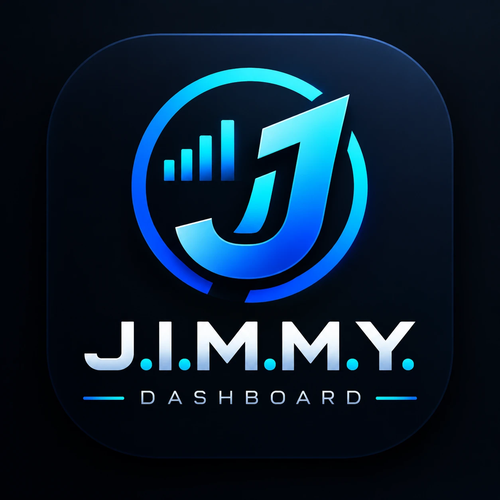
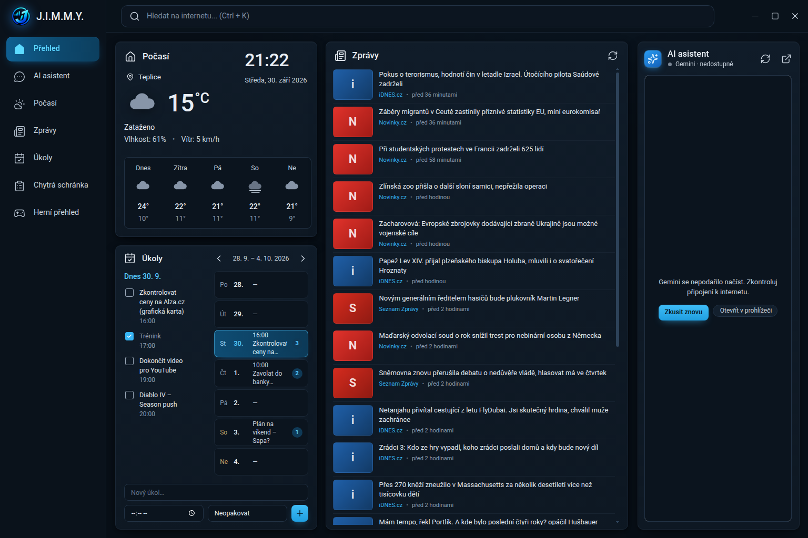

<p align="center"></p>

# J.I.M.M.Y. – osobní dashboard pro Windows

Desktopová aplikace pro Windows (Electron) s dashboardem v tmavém tématu podle návrhu 1536 × 1024 px.
Okno je bez systémového rámečku – titulní lišta z návrhu funguje jako skutečná: tažení okna,
dvojklik pro maximalizaci, tlačítka minimalizovat / maximalizovat / zavřít.



## Stažení

Sestavený soubor je v GitHub Actions → workflow **Windows build** → artefakt `JIMMY-Windows`:
`JIMMY-1.0.0-portable.exe` – stačí stáhnout a spustit, bez instalace.

Aplikace není digitálně podepsaná, takže Windows SmartScreen může při prvním spuštění zobrazit
varování → **Další informace** → **Přesto spustit**.

## Co funguje „naostro“

- **Levé menu** přepíná pohledy: Přehled, AI asistent (Gemini přes celou šířku), Počasí, Zprávy,
  Úkoly, Chytrá schránka a Herní přehled (jednotlivé sekce přes celou plochu).
- **AI asistent** = [Gemini](https://gemini.google.com/app) vložené v pravém panelu (Electron `<webview>`,
  vlastní trvalé úložiště → přihlášení Google účtem vydrží i po restartu). Odkazy z odpovědí se otevírají
  ve výchozím prohlížeči; tlačítka v hlavičce: znovu načíst / otevřít v prohlížeči.
- **Počasí pro Teplice** živě z Open-Meteo (aktuální stav + předpověď na 5 dní, obnova každých 30 min),
  hodiny a datum v téže kartě.
- **Zprávy** se načítají živě z RSS webů Seznam Zprávy, Novinky.cz a iDNES.cz (každých 15 minut
  nebo tlačítkem obnovit). Zdroje se střídají a stejná událost z více webů se zobrazí jen jednou
  (porovnání klíčových slov titulku a perexu). Kliknutí otevře článek v prohlížeči.
- **Úkoly – týdenní kalendář:** dny v týdnu (šipkami se přepíná týden, klik na datum vrátí
  na dnešek) a úkoly vybraného dne s možností přidat (i s časem), odškrtnout a smazat.
  Úkol lze nastavit na opakování **každý den** nebo **každý týden** (ve stejný den v týdnu);
  opakovaný úkol se odškrtává zvlášť pro každý den, smazání odstraní celou řadu.
- **Chytrá schránka:** historie kopírovaného textu z celého Windows (vyhledávání, připnutí, mazání,
  pozastavení záznamu), klik = zkopírovat zpět, **Vložit** = schová aplikaci a vloží text do předchozího
  okna (Ctrl+V). Zkratka **Alt+Shift+V** otevře schránku odkudkoliv. **AI úprava textu** (oprava pravopisu,
  zkrácení, formálněji, překlad, shrnutí, vlastní pokyn) přes Gemini API s vlastním bezplatným klíčem
  z [aistudio.google.com/apikey](https://aistudio.google.com/apikey) (uložen šifrovaně); bez klíče se
  zadání připraví do schránky a otevře se Gemini.
- **Ukládání:** úkoly a historie schránky zůstávají i po restartu aplikace.
- Herní přehled obsahuje zatím ukázková data.

## Vývoj

```bash
npm install
npm start            # spustí aplikaci
npm run dist         # sestaví portable .exe do složky dist/ (na Windows)
```

| Soubor | Obsah |
| --- | --- |
| `main.js` | Hlavní proces Electronu: okno bez rámečku, zprávy, počasí, zabezpečení webview s Gemini |
| `news.js` | Stažení a zpracování RSS, odstranění duplicitních témat |
| `weather.js` | Počasí z Open-Meteo (Teplice) |
| `clipboard.js` | Chytrá schránka: historie, vkládání, AI úpravy přes Gemini API |
| `preload.js` | Bezpečný most mezi stránkou a hlavním procesem (`window.desktop`) |
| `index.html` | Markup dashboardu |
| `styles.css` | Design tokeny (`:root`), layout, komponenty, stavy hover/active/focus |
| `script.js` | Pohledy z menu, hodiny, počasí, zprávy, týdenní kalendář, Gemini, ovládání okna |
| `assets/img/` | Náhradní (placeholder) SVG obrázky |
| `vendor/` | Lokální kopie ikon Lucide a písma Roboto |
| `build/icon.png` | Ikona aplikace |

## Layout

- **Shell:** CSS Grid `sidebar | obsah`, horní lišta je `sticky`.
- **Přehled:** vlevo Počasí s hodinami a pod ním Úkoly, vpravo širší Zprávy přes celou výšku.
- **Vpravo:** AI asistent (Gemini) na celou výšku okna.
- **Container queries** přizpůsobují vnitřek karet jejich šířce (předpověď počasí pod teplotu,
  herní karty ve vodorovném posuvníku).

| Šířka okna | Chování |
| --- | --- |
| ≥ 1440 px | Rozložení 1 : 1 podle návrhu (výchozí velikost okna) |
| 1280–1439 px | Střed ve 2 sloupcích |
| 1100–1279 px | Sidebar se zúží na lištu s ikonami |
| 1024–1099 px | Pravý panel se přesune pod obsah (minimální šířka okna je 1024 px) |

## Úpravy vzhledu

Barvy, rádiusy, stíny a rozměry jsou v CSS proměnných na začátku `styles.css`
(`--bg`, `--card`, `--accent`, `--green`, `--sidebar-w`, `--rightbar-w` …).

Všechna tlačítka, checkboxy, dny kalendáře a textová pole mají odlišené
stavy `:hover`, `:active` a `:focus-visible`; animace respektují `prefers-reduced-motion`.

## Poznámky

- Obrázky her v `assets/img/` jsou jen zástupné ilustrace – nahraďte je skutečnými.
- Hodiny v kartě Počasí ukazují aktuální čas a datum (česky).
- Dva překlepy z návrhu jsou opravené: „Herni přehled“ → „Herní přehled“,
  „Které hry dneska hrajú?“ → „Které hry dneska hrají?“.
