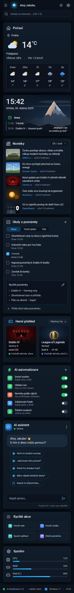

# Jimmy – AI Dashboard

Responzivní UI dashboardu v tmavém tématu (HTML + CSS Grid/Flexbox + trocha JavaScriptu),
postavené podle návrhu 1536 × 1024 px.


## Spuštění

Stačí otevřít `index.html` v prohlížeči. Případně přes lokální server:

```bash
npx serve .
```

Ikony (Lucide) a písmo (Roboto) se načítají z CDN, takže je potřeba připojení k internetu.

## Struktura

| Soubor | Obsah |
| --- | --- |
| `index.html` | Kompletní markup: levý sidebar, horní lišta, 6 widgetů ve středu, pravý panel (AI chat, rychlé akce, systém), stavový řádek |
| `styles.css` | Design tokeny (`:root`), layout, komponenty, stavy hover/active/focus, responzivita |
| `script.js` | Živé hodiny, filtr novinek, záložky a přidávání úkolů, editace poznámek, simulovaný chat, mobilní menu, `Ctrl + K` |
| `assets/img/` | Náhradní (placeholder) SVG obrázky ve stejných poměrech stran jako v návrhu |

## Layout

- **Shell:** CSS Grid `sidebar | obsah`, horní lišta a stavový řádek jsou `sticky`.
- **Střed:** mřížka o 4 stopách (`416fr 100fr 32fr 374fr`) s pojmenovanými oblastmi, která věrně
  skládá „posunuté“ řádky z návrhu (Novinky přesahují pod Úkoly, Automatizace začíná nad Herním přehledem).
- **Container queries** přizpůsobují vnitřek karet jejich šířce (předpověď počasí pod teplotu,
  poznámky pod seznam úkolů, herní karty ve vodorovném posuvníku).

| Šířka okna | Chování |
| --- | --- |
| ≥ 1440 px | Rozložení 1 : 1 podle návrhu |
| 1280–1439 px | Střed ve 2 sloupcích |
| 1100–1279 px | Sidebar se zúží na lištu s ikonami |
| 960–1099 px | Pravý panel se přesune pod obsah |
| < 960 px | Sidebar se vysouvá tlačítkem ☰ (off-canvas) |
| < 720 px | Vše v jednom sloupci |

## Úpravy vzhledu

Barvy, rádiusy, stíny a rozměry jsou v CSS proměnných na začátku `styles.css`
(`--bg`, `--card`, `--accent`, `--green`, `--sidebar-w`, `--rightbar-w` …).

Všechna tlačítka, checkboxy, přepínače, záložky, výběr zdroje novinek a textová pole mají odlišené
stavy `:hover`, `:active` a `:focus-visible`; animace respektují `prefers-reduced-motion`.

## Poznámky

- Obrázky v `assets/img/` jsou jen zástupné ilustrace – nahraďte je skutečnými (stejné poměry stran).
- Hodiny ve widgetu i ve stavovém řádku ukazují aktuální čas a datum (česky); v HTML je jako
  výchozí hodnota stav z návrhu.
- Dva překlepy z návrhu jsou opravené: „Herni přehled“ → „Herní přehled“,
  „Které hry dneska hrajú?“ → „Které hry dneska hrají?“.

<details>
<summary>Náhled na mobilu (390 px)</summary>


</details>
